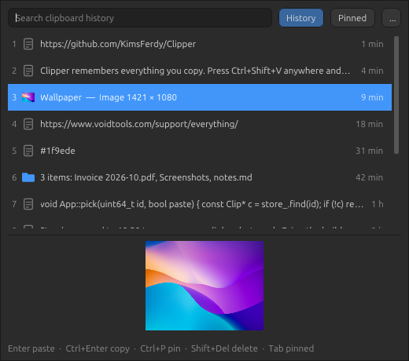
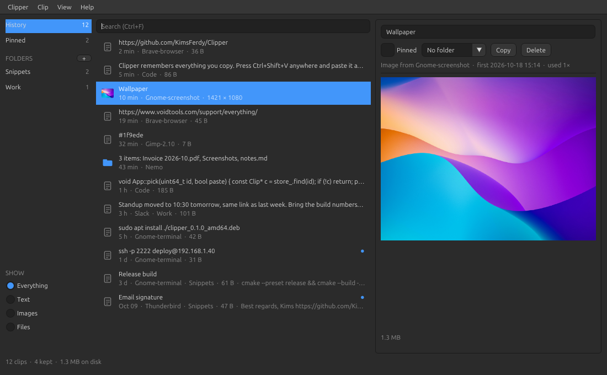
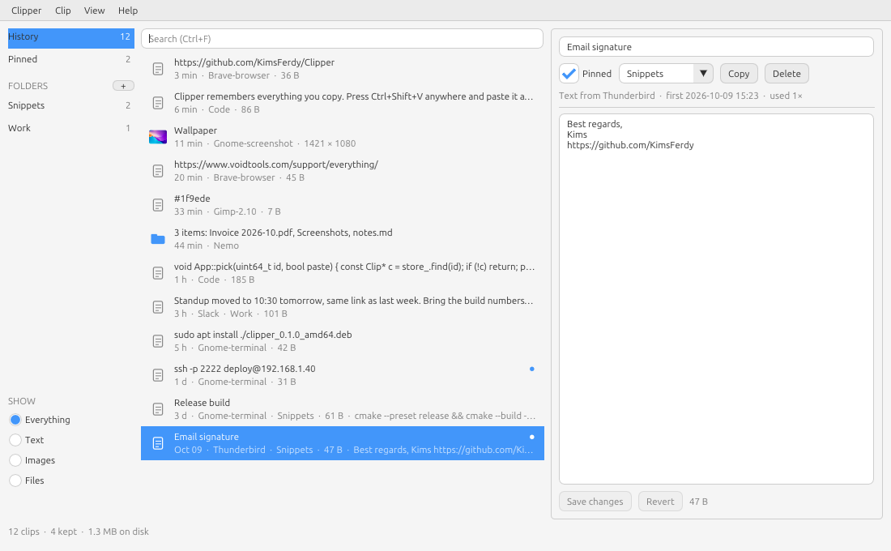

<p align="center">
  
</p>

<h1 align="center">Clipper</h1>

<p align="center">
  <b>Everything you copy, one shortcut away.</b><br>
  Clipboard history for Linux, inspired by <a href="https://clipclip.com/">ClipClip</a>.
</p>

<p align="center">
  <a href="https://github.com/KimsFerdy/Clipper/releases/latest"></a>
  
  <a href="LICENSE"></a>
</p>

<p align="center">
  
</p>

---

Clipper remembers what you copy: text, images and files. `Ctrl+V` pastes as usual. Press `Ctrl+Shift+V`
and a popup opens at your mouse with your history. Type to filter, press `Enter`, and the clip gets pasted
into the app you were in.

- **Popup at the mouse.** Search as you type, `Enter` pastes, `Ctrl+1`…`9` pastes that row
- **Text, images and files.** Screenshots and copied pictures are kept as PNG. Files copied in the file
  manager are kept as a copy command: paste them from the popup into any folder and they get copied there
- **Organize.** Pin clips, give them titles, edit them, and drag them into folders. Pinned clips and clips in
  folders are never cleaned up
- **Keeps the clipboard alive.** When the app you copied from quits, what you copied stays pasteable
- **Leaves passwords alone.** Copies that password managers mark as secret (KeePassXC does) are never saved.
  You can also exclude apps by name, or pause capturing from the tray
- **Feels native.** Uses your system font, dark / light mode and accent colour, and lives in the tray
- **Small.** One binary, C++20 + Dear ImGui, no Qt or GTK

## Download

<p>
  <a href="https://github.com/KimsFerdy/Clipper/releases/latest"><b>➜ Get the latest release</b></a> (early beta)
</p>

| Package | Best for | Install |
|---|---|---|
| `.deb` | Ubuntu 24.04+, Linux Mint 22+, Debian 13+ | `sudo apt install ./clipper_0.1.0~beta_amd64.deb` |
| `AppImage` | Any recent distro, no install | `chmod +x Clipper-*.AppImage && ./Clipper-*.AppImage` |
| `.tar.gz` | Manual install into `~/.local` | `tar xzf clipper-*.tar.gz && cp -r clipper-*/{bin,share} ~/.local/` |

Binaries are x86_64, built on Linux Mint 22 (glibc 2.39). Checksums are in `SHA256SUMS` on the release page.

## Screenshots

<p align="center">
  
</p>
<p align="center">
  
</p>

## Keys

| Popup                 |                                   |
|-----------------------|-----------------------------------|
| `Ctrl+Shift+V`        | open it (from any app)            |
| type                  | search                            |
| `↑` `↓`               | pick a clip                       |
| `Enter` / click       | paste it into the app you were in |
| `Ctrl+Enter`          | put it on the clipboard only      |
| `Ctrl+1` … `Ctrl+9`   | paste that row                    |
| `Tab`                 | history / pinned                  |
| `Ctrl+P`              | pin / unpin                       |
| `Shift+Del`           | delete                            |
| `Ctrl+M`              | open the manager                  |
| `Esc`                 | close                             |

In the manager: `Enter` or a double click copies, `Ctrl+F` searches, `F2` sets a title, `Del` deletes,
and you can drag clips onto *Pinned* or a folder.

### Terminals

Your desktop now sends `Ctrl+Shift+V` to Clipper, so terminals don't get it as their paste key any more. You
can still paste in a terminal: open the popup with `Ctrl+Shift+V` and press `Enter`. Clipper recognises
terminals and pastes with `Shift+Insert` there. If you'd rather keep `Ctrl+Shift+V` for terminals, pick
another shortcut in *Preferences*.

## Requirements

- Linux with an **X11** session (Cinnamon, MATE, Xfce, GNOME on Xorg...). Wayland isn't supported yet
- The shortcut gets set up automatically on Cinnamon and GNOME. On other desktops, add a custom shortcut that
  runs `Clipper --popup`
- Auto-paste needs `libxtst6`, which comes with every desktop install

## Build from source

```bash
scripts/install-deps-linux.sh        # debian / ubuntu / mint
cmake --preset release
cmake --build --preset release
./build/release/Clipper
cmake --install build/release --prefix ~/.local   # app menu entry + icon
```

The first configure downloads GLFW, Dear ImGui and stb (git + network needed once).
Run the tests with `ctest --preset debug` after `cmake --preset debug && cmake --build --preset debug`.

## Where things are

| What                | Where                                           |
|---------------------|-------------------------------------------------|
| History             | `~/.local/share/clipper/history.bin`            |
| Images              | `~/.local/share/clipper/images/*.png`           |
| Settings            | `~/.config/clipper/settings.ini` (hand-editable) |
| Start at login      | `~/.config/autostart/clipper.desktop`           |

## Command line

```
Clipper              open the manager (or start in the tray)
Clipper --popup      open the history popup at the mouse (what the shortcut runs)
Clipper --toggle     show / hide the manager
Clipper --minimized  start in the tray (the login autostart uses this)
```

## License

MIT
